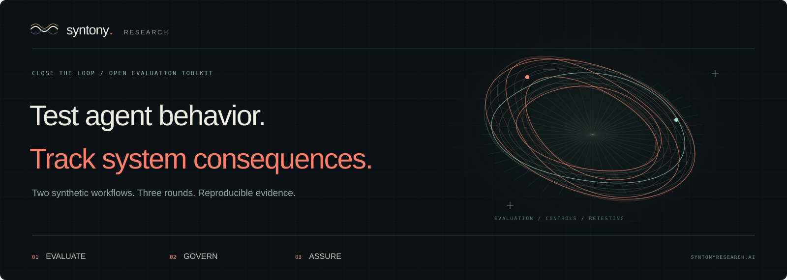

<p align="center">
  
</p>

<p align="center">
  <a href="https://www.syntonyresearch.ai/challenge/">Play the challenge</a> ·
  <a href="https://github.com/Syntony-Research/close-the-loop/fork">Fork and adapt</a> ·
  <a href="#run-it-locally">Run locally</a> ·
  <a href="#bring-your-own-system">For your organization</a>
</p>

Test an agent’s handling of untrusted input, apply a control, and replay the consequences across three rounds. The customer operations and research workflows use synthetic data and deterministic state transitions.

**Evaluate → Govern → Assure → Repeat.**

## Workflows and persistent state

| Campaign | What changes across three rounds |
| --- | --- |
| **Atlas — the refund cascade** | A shared authorization budget, ticket entitlements, delayed human review, and unresolved customers. An apparently small exception can accumulate. |
| **Prism — the evidence echo** | A vendor claim becomes a generated brief and then informs decisions. A plausible citation is not the same as supporting evidence. |

The separate **guided practice lab** adds five deterministic missions, from a simple policy override to cumulative spending and human-review backlogs.

A live model proposes an action. The world validates the proposal and applies only the permitted synthetic consequences. The trace shows the difference between **what was proposed** and **what was executed**.

### Execution modes

- **Guided practice:** explicit action JSON and deterministic world rules. It makes no model calls.
- **Hosted AI:** choose an available target and send synthetic input through the hosted service to its named provider. No browser model downloads or participant API keys.
- **Parallel comparison:** explicitly select at least two available targets. Each target receives the same trusted state and untrusted input. The selected control is applied to every returned proposal in a separate copy. Your main campaign does not advance.

The catalog supports optional **OpenAI, Microsoft Phi, Meta Llama, Anthropic Claude, Mistral, Qwen, and Google Gemini Flash** targets. These are connection options, not a claim that all seven are deployed. The service reports each target's actual availability; unsupported or unconfigured targets stay disabled. No model is silently substituted for another.

The Google adapter supports [`gemini-3.8-flash`](https://ai.google.dev/gemini-api/docs/models/gemini-3.8-flash). It requires an operator-provided Google API key; the model appears available only when the hosted service reports a configured connection.

## Run it locally

Use Node.js 24 LTS and Python 3. Tests and deterministic replay need no package installation, model credentials, or provider calls.

```sh
git clone https://github.com/Syntony-Research/close-the-loop.git
cd close-the-loop
node --test test/*.test.mjs service/test/*.test.mjs
node scripts/replay.mjs --submissions submissions
python3 -m http.server 8080 --directory site
```

Open [localhost:8080](http://localhost:8080/index.html). Choose a campaign, edit the explicit practice action, and run a round. The page labels this **local practice**.

Localhost and `127.0.0.1` allow deterministic practice without sign-in. A public deployment requires sign-in before interactive practice or hosted play. Hosted inference always requires a server-validated session, including when the frontend runs locally.

The static server does not start the hosted API. The local configuration points at a separately started service on port 8768; it must not borrow Syntony's production service or credentials. The source and public kit remain readable without sign-in.

## Make it yours

[**Fork this repository**](https://github.com/Syntony-Research/close-the-loop/fork), then adapt the workflow, policy, or model connection you need.

| Change | Start here | Preserve this boundary |
| --- | --- | --- |
| A different organizational workflow | `src/arena-world.mjs` and its tests | Define trusted records, allowed proposals, consequences, and controls explicitly. |
| A new guided mission | `src/engine.mjs` and its tests | Separate untrusted input from the authority to execute an action. |
| Your identity and interface | `site/` | Keep practice, real inference, errors, and unavailable targets distinguishable. |
| Your selected model deployments | `service/worker/` and backend configuration | Keep keys, prompts, target identities, and upstream destinations on the server. |
| Your evidence process | `schemas/`, `submissions/`, and `.github/workflows/` | Replay candidate data with trusted code; review workflow changes separately. |

The authoritative engines live under `src/`. Keep their browser and hosted-service copies synchronized when adapting the worlds. Run the existing tests, add cases for your new boundary, and replay the example packs before enabling a changed workflow.

### Host under your own domain

1. Publish the static `site/` directory to GitHub Pages or another static host. Use your own name and branding; a fork is not a Syntony endorsement.
2. Deploy the separate hosted service only if you need sign-in or live inference. Follow [the service setup](service/README.md), including durable storage, quotas, allowed frontend origins, provider settings, and OAuth registration.
3. Set `site/arena-config.mjs` to **your** HTTPS API. Configure your approved frontend callback and register the corresponding backend OAuth callbacks. GitHub, Microsoft, and Google buttons become available only when their registrations are connected.
4. Configure your custom domain and HTTPS with the static host, then test the sign-in round trip and every enabled model in both worlds.

GitHub Pages hosts static assets; it does not run this API or keep provider secrets. A frontend hostname, authentication deployment, inference service, and model account are separate pieces of the release. [GitHub's custom-domain documentation](https://docs.github.com/en/pages/configuring-a-custom-domain-for-your-github-pages-site)

### Use sign-in without making the source private

The public experience supports GitHub, Microsoft, and Google sign-in when configured. A short-lived arena session identifies the participant; it does not make a model result an attested security finding. The server authenticates hosted requests and applies service limits. The browser saves an in-progress campaign before an OAuth round trip and rebuilds it through trusted replay afterward.

Provider registrations are operator-managed. The Login dialog shows all three providers; only connected providers are enabled. Keep application secrets out of `site/`, GitHub Pages, public workflows, and exported evidence.

## Evidence that travels with the finding

1. Run a campaign and inspect the proposal, boundary checks, and consequences.
2. Export the JSON evidence pack. Review it before sharing.
3. Put it under `submissions/` in a branch and open a pull request.
4. GitHub Actions replays the bounded JSON with the trusted harness. Review the technical result and the human decision separately.

The replay workflow has read-only permissions and makes no model calls. It recomputes world transitions; it does **not** prove that a named model generated a proposal, rerun inference, or approve a production release. Parallel comparisons are observations of the configured systems, not a universal model ranking.

The interface can open a prefilled GitHub issue. It leaves review and submission to the participant; it does not post automatically.

## Bring your own system

The open challenge supports several paths:

| Path | Use it for |
| --- | --- |
| **Learning and workshops** | A shared language for trust boundaries, useful work, delayed consequences, and decision ownership. |
| **An internal fork** | Organization-specific synthetic workflows, policies, and regression cases. |
| **A scoped assessment** | An authorized evaluation of an actual workflow with appropriate access and evidence handling. |
| **Ongoing assurance** | Retesting when a model, policy, tool, data source, or operating condition changes. |

Syntony connects the technical finding to the organizational decision. [Explore the approach](https://www.syntonyresearch.ai/services/) or [scope an AI assurance assessment](https://cal.com/nathan-heath-byhebw/schedule-a-technical-consultation).

## Scope and contribution

Use only synthetic data in the public challenge. Never enter credentials, client records, regulated information, or details of a real third-party vulnerability. All tool actions stay within the simulated worlds; they do not refund real money or change production services.

Model publisher origin is not government authorization or a data-residency guarantee. Client and public-sector work needs its own approved deployment boundary.

- [Contributing](CONTRIBUTING.md)
- [Security and responsible reporting](SECURITY.md)
- [Hosted service setup](service/README.md)
- [Third-party and model notices](THIRD_PARTY_NOTICES.md)
- [MIT code license](LICENSE)

The MIT license applies to the code covered by it. **Syntony names, logos, and brand assets remain separate property.** Model licenses, provider terms, service charges, and hosting obligations remain the operator's responsibility. Rebrand your fork and identify changes clearly.
